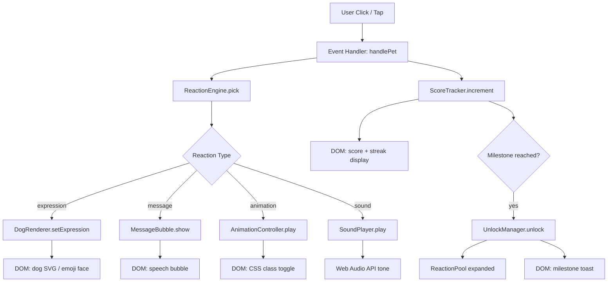
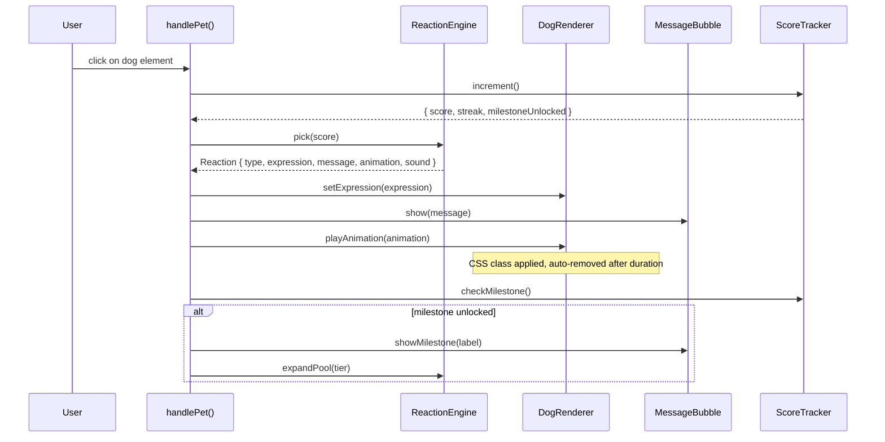
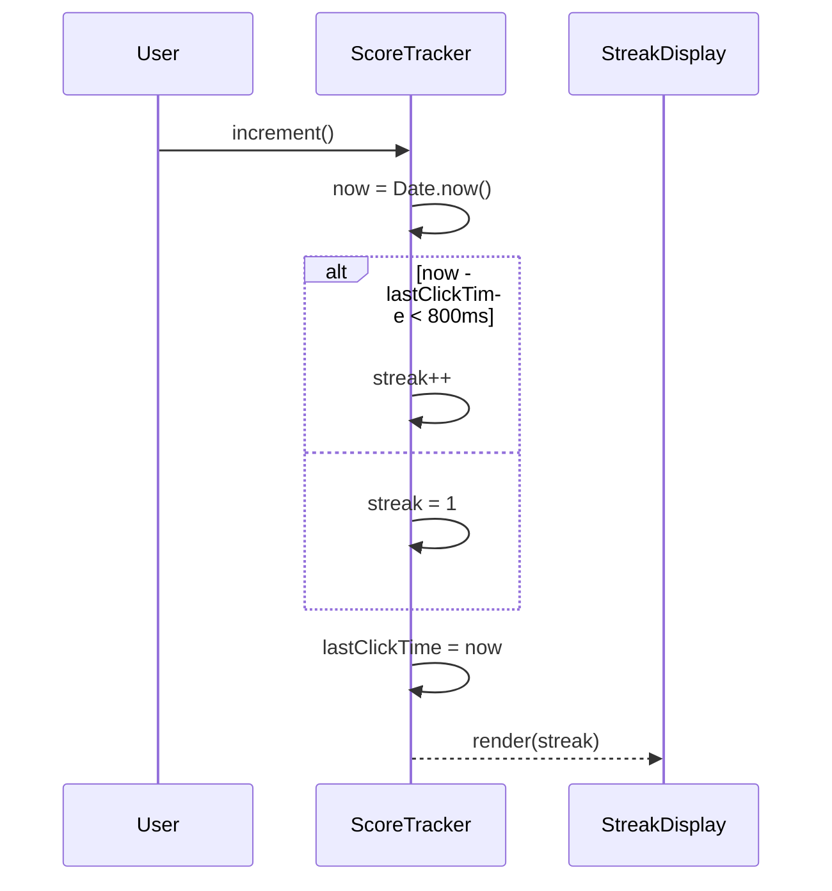

# Design Document: Dog Petter Clicker

## Overview

A single-page clicker web app where the user pets a cute minimalist dog character to trigger random, delightful reactions. The app is built as a single HTML file using Tailwind CSS for layout and styling, and Vanilla JavaScript for all interactivity. The core engagement loop is simple: click the dog, see something charming happen, keep clicking.

The app tracks a "happiness score" that grows with each pet, unlocks new reactions as milestones are reached, and shows a streak counter to reward fast clicking. Everything is self-contained in one HTML file — no build step, no dependencies beyond a Tailwind CDN link.

## Architecture



## Sequence Diagrams

### Primary Pet Interaction Flow



### Streak Detection Flow



## Components and Interfaces

### DogRenderer

**Purpose**: Owns the dog's visual representation — an SVG-based minimalist dog face that changes expression and plays animations via CSS class toggles.

**Interface**:
```javascript
/**
 * @typedef {'happy'|'love'|'surprised'|'sleepy'|'dizzy'|'tongue'|'wink'} Expression
 * @typedef {'bounce'|'shake'|'spin'|'wiggle'|'zoom'|'float'} AnimationName
 */

const DogRenderer = {
  /** Set the dog's current face expression */
  setExpression(expression: Expression): void,

  /** Trigger a CSS animation by name; auto-removes class after duration ms */
  playAnimation(name: AnimationName, duration?: number): void,

  /** Reset dog to idle/neutral state */
  reset(): void,
}
```

**Responsibilities**:
- Maintain the dog SVG/emoji DOM element
- Map expression names to SVG/HTML snippets
- Apply and remove CSS animation classes on a timer
- Prevent animation stacking (cancel in-flight animation before starting a new one)

### ReactionEngine

**Purpose**: Selects a random reaction from the currently unlocked pool, weighted by rarity tier.

**Interface**:
```javascript
/**
 * @typedef {{ expression: Expression, message: string, animation: AnimationName, sound: string|null, weight: number }} Reaction
 */

const ReactionEngine = {
  /** Pick a random Reaction from unlocked pool, weighted by .weight */
  pick(currentScore: number): Reaction,

  /** Add reactions from a new tier to the active pool */
  expandPool(tier: 'common'|'rare'|'legendary'): void,
}
```

**Responsibilities**:
- Hold a master catalogue of all reactions across tiers
- Perform weighted random selection
- Track which tiers are currently unlocked

### ScoreTracker

**Purpose**: Maintains game state — total pets, current streak, and milestone detection.

**Interface**:
```javascript
/**
 * @typedef {{ score: number, streak: number, milestoneUnlocked: Milestone|null }} PetResult
 * @typedef {{ threshold: number, label: string, tier: 'common'|'rare'|'legendary' }} Milestone
 */

const ScoreTracker = {
  /** Record one pet. Returns updated state including any newly triggered milestone. */
  increment(): PetResult,

  /** Return current score without side effects */
  getScore(): number,

  /** Return current streak count */
  getStreak(): number,

  /** Reset all state */
  reset(): void,
}
```

**Responsibilities**:
- Increment score on each call
- Track time of last click to calculate streak
- Compare score against milestone thresholds
- Persist score to `localStorage` so it survives a page refresh

### MessageBubble

**Purpose**: Shows a speech-bubble tooltip above the dog with reaction text, then fades it out.

**Interface**:
```javascript
const MessageBubble = {
  /** Display text in the bubble for durationMs, then fade */
  show(text: string, durationMs?: number): void,

  /** Show a special milestone announcement */
  showMilestone(label: string): void,

  /** Immediately hide bubble */
  hide(): void,
}
```

### SoundPlayer

**Purpose**: Plays short, cheerful audio cues using the Web Audio API (no external audio files required).

**Interface**:
```javascript
const SoundPlayer = {
  /** Play a named sound cue */
  play(soundName: 'boop'|'squeak'|'sparkle'|'tada'|'woof'): void,

  /** Toggle mute globally */
  setMuted(muted: boolean): void,
}
```

**Responsibilities**:
- Generate simple tones and chords programmatically via `AudioContext`
- Resume `AudioContext` on first user gesture (browser autoplay policy)
- Respect mute toggle

## Data Models

### Reaction

```javascript
/**
 * @typedef {Object} Reaction
 * @property {Expression}      expression  - Dog face to display
 * @property {string}          message     - Speech bubble text
 * @property {AnimationName}   animation   - CSS animation to play
 * @property {string|null}     sound       - SoundPlayer key, or null for silent
 * @property {number}          weight      - Relative selection weight (1–10)
 * @property {'common'|'rare'|'legendary'} tier
 */
```

**Validation Rules**:
- `weight` must be a positive integer
- `message` must be non-empty
- `expression` must be one of the defined Expression values

### Milestone

```javascript
/**
 * @typedef {Object} Milestone
 * @property {number}  threshold  - Score at which this unlocks
 * @property {string}  label      - Display text shown in toast
 * @property {'common'|'rare'|'legendary'} tier  - Reaction tier unlocked
 */
```

**Milestone thresholds**:
- 10 pets → "Good boy energy!" — unlocks `rare` reactions
- 50 pets → "Absolute legend!" — unlocks `legendary` reactions
- 100 pets → "Professional petter!" — cosmetic badge only

### GameState

```javascript
/**
 * @typedef {Object} GameState
 * @property {number}   score          - Total pets given
 * @property {number}   streak         - Current fast-click streak count
 * @property {number}   lastClickTime  - Timestamp of last click (ms)
 * @property {string[]} unlockedTiers  - Tiers currently available
 */
```

## Algorithmic Pseudocode

### handlePet — Main Click Handler

```pascal
PROCEDURE handlePet(clickEvent)
  INPUT: clickEvent (MouseEvent | TouchEvent)
  OUTPUT: void (DOM side effects)

  SEQUENCE
    // 1. Prevent double-fire on rapid clicks during animation
    IF dogElement.classList.contains('animating') THEN
      // still register the score, skip the visual
      ScoreTracker.increment()
      RETURN
    END IF

    // 2. Update score and streak
    result ← ScoreTracker.increment()

    // 3. Pick a reaction from the unlocked pool
    reaction ← ReactionEngine.pick(result.score)

    // 4. Apply visual reaction
    DogRenderer.setExpression(reaction.expression)
    DogRenderer.playAnimation(reaction.animation)
    MessageBubble.show(reaction.message)

    // 5. Play sound (if not muted)
    IF reaction.sound IS NOT NULL THEN
      SoundPlayer.play(reaction.sound)
    END IF

    // 6. Update HUD
    renderScore(result.score)
    renderStreak(result.streak)

    // 7. Handle milestone
    IF result.milestoneUnlocked IS NOT NULL THEN
      ReactionEngine.expandPool(result.milestoneUnlocked.tier)
      MessageBubble.showMilestone(result.milestoneUnlocked.label)
      SoundPlayer.play('tada')
    END IF
  END SEQUENCE
END PROCEDURE
```

**Preconditions:**
- Dog element exists in the DOM
- ScoreTracker, ReactionEngine, DogRenderer, MessageBubble are initialized
- clickEvent originates from the dog element

**Postconditions:**
- score is incremented by exactly 1
- One reaction from the unlocked pool is displayed
- If a milestone threshold was crossed, the tier is expanded exactly once

**Loop Invariants:** N/A

### ReactionEngine.pick — Weighted Random Selection

```pascal
PROCEDURE pick(currentScore)
  INPUT: currentScore (number ≥ 0)
  OUTPUT: reaction (Reaction)

  SEQUENCE
    pool ← unlocked reactions from activePools
    totalWeight ← 0

    FOR each reaction IN pool DO
      totalWeight ← totalWeight + reaction.weight
    END FOR

    roll ← Math.random() × totalWeight
    cumulative ← 0

    FOR each reaction IN pool DO
      cumulative ← cumulative + reaction.weight
      IF roll < cumulative THEN
        RETURN reaction
      END IF
    END FOR

    // Fallback: return last reaction (floating-point safety)
    RETURN pool[pool.length - 1]
  END SEQUENCE
END PROCEDURE
```

**Preconditions:**
- `pool` has at least one reaction
- All `reaction.weight` values are positive numbers

**Postconditions:**
- Returns exactly one Reaction from the pool
- Higher-weight reactions are selected proportionally more often

**Loop Invariants:**
- `cumulative` is always ≤ `totalWeight` after each iteration
- `roll` is always in [0, totalWeight)

### ScoreTracker.increment — Score + Streak Update

```pascal
PROCEDURE increment()
  INPUT: none
  OUTPUT: PetResult { score, streak, milestoneUnlocked }

  SEQUENCE
    state.score ← state.score + 1
    now ← Date.now()

    IF (now - state.lastClickTime) < STREAK_WINDOW_MS THEN
      state.streak ← state.streak + 1
    ELSE
      state.streak ← 1
    END IF

    state.lastClickTime ← now

    // Check milestones in order
    milestoneUnlocked ← null
    FOR each milestone IN MILESTONES DO
      IF state.score = milestone.threshold THEN
        milestoneUnlocked ← milestone
        BREAK
      END IF
    END FOR

    // Persist to localStorage
    localStorage.setItem('dogPetterState', JSON.stringify(state))

    RETURN { score: state.score, streak: state.streak, milestoneUnlocked }
  END SEQUENCE
END PROCEDURE
```

**Preconditions:**
- `state.score` is a non-negative integer
- `STREAK_WINDOW_MS` is a positive constant (default: 800)

**Postconditions:**
- `state.score` increases by exactly 1
- `state.streak` is ≥ 1
- If score equals a milestone threshold, that milestone is returned exactly once

**Loop Invariants:**
- Milestones are checked in ascending threshold order

## Key Functions with Formal Specifications

### DogRenderer.playAnimation

```javascript
function playAnimation(name, duration = 600) {
  dogEl.classList.remove(...ALL_ANIMATION_CLASSES)
  dogEl.classList.add(name, 'animating')
  setTimeout(() => {
    dogEl.classList.remove(name, 'animating')
  }, duration)
}
```

**Preconditions:**
- `name` is a valid AnimationName
- `dogEl` references a live DOM element
- `duration` is a positive number

**Postconditions:**
- Exactly one animation class is active at a time
- `animating` guard class is removed after `duration` ms
- No previous animation classes remain active

### SoundPlayer.play — Programmatic Tone Generation

```javascript
function play(soundName) {
  if (muted) return
  const ctx = getAudioContext()   // resumes if suspended
  const config = SOUND_MAP[soundName]
  const osc = ctx.createOscillator()
  const gain = ctx.createGain()
  osc.connect(gain)
  gain.connect(ctx.destination)
  osc.type = config.type          // 'sine' | 'square' | 'triangle'
  osc.frequency.setValueAtTime(config.freq, ctx.currentTime)
  gain.gain.setValueAtTime(0.3, ctx.currentTime)
  gain.gain.exponentialRampToValueAtTime(0.001, ctx.currentTime + config.duration)
  osc.start(ctx.currentTime)
  osc.stop(ctx.currentTime + config.duration)
}
```

**Preconditions:**
- `soundName` exists in `SOUND_MAP`
- Browser supports Web Audio API

**Postconditions:**
- A tone plays for `config.duration` seconds and then stops automatically
- No audio nodes are leaked (osc.onended cleanup)

## Example Usage

```javascript
// Bootstrap
document.addEventListener('DOMContentLoaded', () => {
  ScoreTracker.init()       // loads from localStorage if available
  ReactionEngine.init()     // loads common reactions
  DogRenderer.init()        // attaches to #dog element
  MessageBubble.init()      // attaches to #bubble element
  SoundPlayer.init()        // creates AudioContext lazily

  document.getElementById('dog').addEventListener('click', handlePet)
  document.getElementById('dog').addEventListener('touchend', handlePet)
})

// Typical interaction sequence
handlePet(event)
// → ScoreTracker returns { score: 11, streak: 3, milestoneUnlocked: null }
// → ReactionEngine.pick(11) returns { expression: 'love', message: '💖', animation: 'bounce', sound: 'boop', weight: 5, tier: 'common' }
// → Dog bounces with heart eyes, bubble shows 💖, boop sound plays

// Milestone crossing
handlePet(event)
// → ScoreTracker returns { score: 10, streak: 1, milestoneUnlocked: { threshold: 10, label: 'Good boy energy!', tier: 'rare' } }
// → Rare reactions added to pool, milestone toast shown, tada plays
```

## Correctness Properties

*A property is a characteristic or behavior that should hold true across all valid executions of a system — essentially, a formal statement about what the system should do. Properties serve as the bridge between human-readable specifications and machine-verifiable correctness guarantees.*

### Property 1: Score strict monotonicity

*For any* initial Score value, a single call to `ScoreTracker.increment()` increases the Score by exactly 1, never more, never less.

```javascript
const before = ScoreTracker.getScore()
const result = ScoreTracker.increment()
assert(result.score === before + 1)
assert(ScoreTracker.getScore() === before + 1)
```

**Validates: Requirements 1.2, 4.1**

### Property 2: Streak resets on idle gap

*For any* game state, when the gap between two consecutive `increment()` calls is 800 ms or more, the returned Streak equals exactly 1; when the gap is less than 800 ms, the Streak increases by exactly 1.

```javascript
// Cold click path
state.lastClickTime = Date.now() - 1000
const result = ScoreTracker.increment()
assert(result.streak === 1)
```

**Validates: Requirements 4.2, 4.3, 4.5**

### Property 3: Weighted pick stays within the active pool

*For any* unlocked tier configuration, `ReactionEngine.pick()` always returns exactly one Reaction whose Tier is in the set of currently unlocked Tiers, and never a Reaction from a locked Tier.

```javascript
const r = ReactionEngine.pick(score)
assert(activePools.some(pool => pool.includes(r)))
assert(r.tier === 'common' || unlockedTiers.includes(r.tier))
```

**Validates: Requirements 3.1, 3.2, 3.4**

### Property 4: Milestone fires at most once per threshold

*For any* sequence of `increment()` calls, each Milestone is returned at most once — exactly when the Score first equals its threshold — and never again for any subsequent calls.

```javascript
assert(milestoneSeenCount[milestone.threshold] <= 1)
```

**Validates: Requirements 5.1, 5.5**

### Property 5: Animation guard prevents class stacking

*For any* animation name, while the `animating` guard class is present on the Dog element, calling `playAnimation()` does not apply a new animation class; after the animation duration, all animation-related CSS classes are removed.

```javascript
dogEl.classList.add('animating')
DogRenderer.playAnimation('bounce')
assert(!dogEl.classList.contains('bounce'))
```

**Validates: Requirements 2.2, 2.6, 8.4, 8.5**

### Property 6: Muted state produces no audio output

*For any* sequence of `play()` calls following `SoundPlayer.setMuted(true)`, the SoundPlayer must not create or start any `AudioContext` nodes.

```javascript
SoundPlayer.setMuted(true)
SoundPlayer.play('boop')
assert(audioContextNodeCreationCount === 0)
```

**Validates: Requirements 7.3**

### Property 7: Sound cue conditionality

*For any* Reaction, if its `sound` field is non-null then `SoundPlayer.play()` is called with that sound key; if its `sound` field is null then `SoundPlayer.play()` is never called.

**Validates: Requirements 2.4, 2.5**

### Property 8: LocalStorage round-trip

*For any* valid GameState, writing the state to `localStorage` via `ScoreTracker.increment()` and then initialising a fresh ScoreTracker from that storage produces an equivalent Score and unlockedTiers.

**Validates: Requirements 6.1, 6.2**

### Property 9: Reaction expression fidelity

*For any* Reaction selected by `ReactionEngine.pick()`, calling `DogRenderer.setExpression()` with the Reaction's expression sets the Dog element to that exact Expression, with no other Expression classes applied simultaneously.

**Validates: Requirements 2.1, 8.2**

### Property 10: XSS-safe text rendering

*For any* dynamic string rendered into the DOM (reaction messages, milestone labels, score values), the App sets the content via `textContent` and never via `innerHTML`.

**Validates: Requirements 10.1**

## Error Handling

### Web Audio API Not Supported

**Condition**: Browser does not support `AudioContext` (rare, but possible in some environments)
**Response**: `SoundPlayer.play()` silently no-ops; a `console.warn` is emitted once at init
**Recovery**: All other features work normally; mute button is hidden since there's nothing to mute

### localStorage Unavailable

**Condition**: Browser is in private mode or has storage blocked
**Response**: `ScoreTracker` falls back to in-memory state only; no error shown to user
**Recovery**: Score resets on page reload; all gameplay still works

### Rapid Click Overload (animation stacking)

**Condition**: User clicks faster than animation duration (< 600 ms between clicks)
**Response**: The `animating` guard class skips the visual for mid-flight clicks but still increments score
**Recovery**: Dog becomes clickable again automatically after the current animation finishes

### Touch + Click Double-Fire

**Condition**: On mobile, `touchend` and `click` both fire for a single tap
**Response**: `handlePet` calls `event.preventDefault()` on `touchend` to suppress the synthetic click
**Recovery**: Each physical tap registers as exactly one pet

## Testing Strategy

### Unit Testing Approach

Each module is a plain JS object with no DOM dependency at the logic level, making unit testing straightforward.

Key test cases:
- `ScoreTracker.increment()` increments score by 1 each call
- `ScoreTracker.increment()` resets streak when gap > 800 ms
- `ReactionEngine.pick()` always returns a reaction from the active pool
- `ReactionEngine.pick()` respects weights (statistical property over 10 000 samples)
- Milestone fires at exactly the right threshold and not again after

### Property-Based Testing Approach

**Property Test Library**: fast-check

Properties to test:
- For any sequence of `n` clicks, `score === n`
- For any unlocked tier set, `pick()` never returns a reaction from a locked tier
- For any score, `pick()` returns a reaction whose `weight > 0`
- Streak is always in range [1, n] where n is the number of clicks in the current burst

### Integration Testing Approach

Manual smoke test checklist (since it's a single HTML file):
- Click dog 10 times → verify milestone toast and rare reactions appear
- Click dog 50 times → verify legendary reactions unlock
- Reload page → verify score persists from localStorage
- Toggle mute → verify no sound plays after muting
- Run on mobile device → verify no double-fire from touch

## Performance Considerations

- The dog character is SVG-based, so it scales crisply on all screen densities with zero raster cost.
- CSS animations use `transform` and `opacity` only, keeping all animations on the compositor thread (no layout reflow).
- Audio nodes are created per-play and garbage-collected automatically via `osc.onended`; no pooling needed for the cadence of a clicker app.
- The reaction pool is a small static array (< 50 items); no virtualization or lazy loading required.
- `localStorage` writes are synchronous but negligible (< 100 bytes per write).

## Security Considerations

- No user input is ever rendered as HTML; all dynamic text is set via `textContent`, not `innerHTML`, preventing XSS.
- No network requests are made; the app is entirely self-contained.
- `localStorage` stores only the numeric game state, never any sensitive data.

## Dependencies

| Dependency | Source | Purpose |
|---|---|---|
| Tailwind CSS | CDN (`cdn.tailwindcss.com`) | Utility-first layout and styling |
| Web Audio API | Browser built-in | Programmatic sound effects |
| localStorage | Browser built-in | Score persistence across reloads |

No npm packages, no build tooling, no backend.
